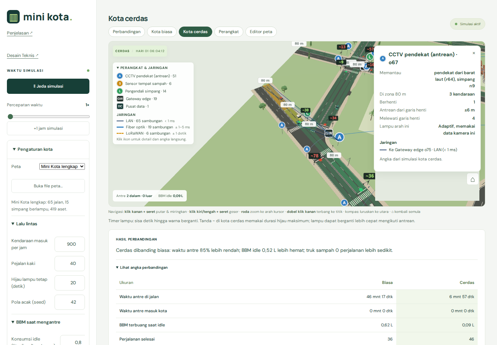
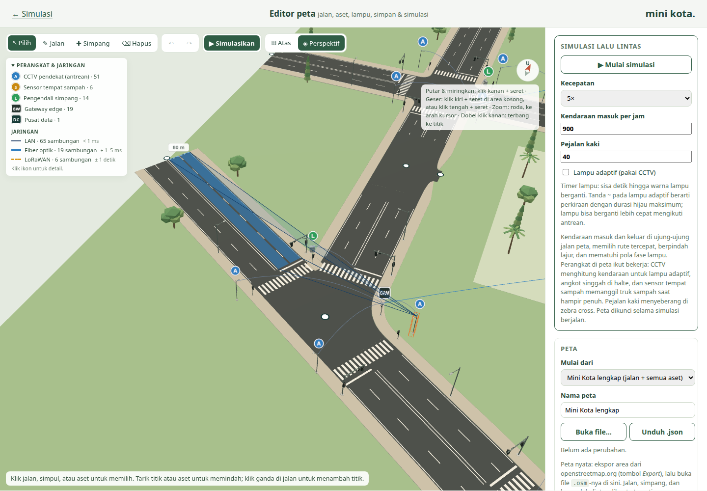

# Rancangan Editor Peta Mini Kota

Dokumen ini adalah pegangan pengembangan editor peta. Isinya bisa diubah; setiap perubahan
keputusan dicatat di bagian **Keputusan**.

## Tujuan

1. Peta bisa dibuat dan diubah dengan **melukis jalan** di kanvas; jalan 3D dan simulasi
   **otomatis mengikuti**.
2. Aset (sensor, lampu, gedung, dan lainnya) dipasang dengan **drag & drop** dari toolbox.
3. Ke depan, peta nyata bisa diimpor dari OpenStreetMap.
4. **Tanpa ketergantungan pihak ketiga** untuk logika peta. Yang dipakai hanya three.js
   (tampilan 3D), Vite (build), dan Blender (membuat aset).

## Keputusan yang sudah disepakati

| Topik | Keputusan |
|---|---|
| Jalan | Tidak dimodelkan di Blender. Dibentuk kode dari **garis tengah + profil penampang** |
| Sumber data | **Satu file peta** (format sendiri) untuk tampilan dan simulasi |
| Cara menggambar | Pilih tool jenis jalan, lalu **klik titik** (bawaan) atau **tarik** (seret bebas) |
| Mengedit | Titik jalan bisa ditarik, ditambah, dihapus; jalan bisa dipotong/disambung; jenis bisa diganti |
| Tempel | Aktif bawaan, jarak 10 m **dari tepi jalan** (bisa diatur), tahan **Alt** untuk menahan tempel, tanda magnet |
| Undo/redo | Wajib; satu langkah termasuk penyesuaian otomatisnya |
| Tool tambah simpang | Klik di badan jalan untuk membuat simpang manual |
| Lampu lalu lintas | Diusulkan otomatis di simpang jalan 2 lajur, bisa diubah per simpang |
| Belok kiri | Bawaan **jalan terus** di perempatan, bisa dimatikan per simpang |
| Toolbox | Aset menempel cerdas ke tempat yang masuk akal, posisi/arah tetap bisa diatur |
| Sensor | Otomatis tersambung ke gateway terdekat, bisa dipindah manual |
| Titik awal | Mini Kota sekarang dikonversi ke format baru; peta kosong juga bisa |
| Lokasi editor | **File HTML terpisah** (`editor-peta.html`) selama pengembangan, lalu menjadi tab |
| Jaringan | Hanya LAN, fiber optik, LoRaWAN |

## Format data peta (versi 1)

Satuan **meter**. Sumbu **x ke timur**, **z ke selatan** (sama dengan bidang tanah three.js).

```json
{
  "format": "minikota-map",
  "version": 1,
  "name": "Mini Kota",
  "bounds": { "width": 614.4, "depth": 409.6 },
  "profiles": {
    "jalan-2x2": { "name": "Jalan 2 lajur per arah", "lanes": [2, 2], "laneWidth": 3.5,
                   "median": 0.6, "curb": 0.2, "sidewalk": 2.5 }
  },
  "nodes": [ { "id": "n1", "x": 61.6, "z": 74.4, "signal": true } ],
  "roads": [ { "id": "r1", "from": "n1", "to": "n2", "profile": "jalan-2x2",
               "shape": "spline", "points": [[90, 80]], "oneway": false } ],
  "lots":  [ { "id": "school", "name": "Sekolah", "x": 220, "z": 204, "w": 52, "d": 38 } ],
  "gates": [ { "id": "gate1", "name": "Gerbang 1", "node": "n40" } ],
  "objects": [ { "asset": "tree-shade", "x": 100, "z": 50, "rotation": 0 } ]
}
```

- **nodes**: titik ujung jalan dan simpang. `signal` menandai simpang berlampu.
- **roads**: garis tengah dari `from` ke `to` melalui `points` (titik antara).
  `shape: "spline"` menghaluskan lengkung; `"polyline"` memakai titik apa adanya.
  `lanes: [maju, mundur]` relatif terhadap arah `from → to`; lalu lintas Indonesia di kiri.
- **profiles**: penampang jalan. Lebar lajur, median, kerb, trotoar.
- **objects**: aset dari `public/models/manifest.json` yang dipasang di peta:
  `{ "id": "o3", "asset": "cctv", "x": 60, "z": 98, "rotation": 270, "gateway": "o2" }`.
  `rotation` dalam derajat; 0 berarti bagian depan aset menghadap selatan (+z).
  `gateway` hanya disimpan bila dipilih manual; tanpa itu sensor memakai gateway terdekat.

### Penempatan cerdas aset

| Aset | Posisi otomatis | Arah |
|---|---|---|
| Lampu lalu lintas, kuning kedip | Tepi kiri pendekat simpang (sisi pengemudi), 6 m sebelum mulut simpang | Menghadap kendaraan yang datang |
| Rambu belok kiri | Sama, 11 m sebelum mulut simpang | Menghadap kendaraan yang datang |
| Lampu pejalan kaki | Di ujung zebra cross | Menghadap seberang jalan |
| Kabinet pengendali, gateway, CCTV dome | Sudut simpang di trotoar | Menghadap simpang |
| Kamera detektor antrean (tiang) | Di seberang simpang dari pendekat terdekat | Menghadap arus yang datang |
| Lampu PJU | Tepi jalan | Lengan ke arah jalan |
| Tempat sampah, halte, bangku | Tepi jalan | Menghadap jalan |
| Pohon, semak | Di belakang trotoar | — |
| Gedung | Tengah kawasan (bila dijatuhkan di kawasan) | Menghadap jalan terdekat |
| Kendaraan | Lajur di sisi kursor | Searah arus lajur |
| Orang | Tengah trotoar | Sejajar jalan |

Tahan **Alt** untuk penempatan bebas. Bila posisi hitungan tetap jatuh di aspal (misalnya
lengan simpang yang melengkung), aset dipindah ke tepi jalan terdekat.

## Pembentukan jalan (tahap 1)

1. Garis tengah dihaluskan (spline) bila diminta, lalu disampel.
2. Simpang = node dengan 3 lengan atau lebih. Ujung setiap lengan dipotong mundur
   (setback) sesuai lebar jalan lain dan sudut antarlengan.
3. Ruas diisi: aspal, kerb, trotoar, marka (garis tengah, garis lajur putus-putus 3 m / 5 m,
   garis tepi).
4. Area simpang: tepi lengan-lengan dihubungkan lengkung sudut; trotoar mengikuti lengkung.
5. Di lengan simpang (bukan akses kawasan, bukan bundaran): **zebra cross** lalu **garis henti**.
6. Node dengan 2 lengan disambung mulus (sudut dibagi dua).
7. Masalah dicatat sebagai **peringatan**: ruas terlalu pendek, sudut terlalu lancip,
   profil berbeda di sambungan (peralihan lajur belum didukung di tahap 1).

## Aturan normalisasi (tahap 3)

| Kondisi | Hasil |
|---|---|
| Ujung jalan baru dekat badan jalan lain | Menempel → pertigaan |
| Ujung jalan baru dekat ujung jalan lain | Digabung → bersambung |
| Jalan memotong jalan lain | Titik potong → perempatan |
| Dua simpang terlalu dekat | Digabung |
| Ruas sangat pendek di antara dua simpang | Dihapus/digabung |
| Sudut lengan sangat lancip | Peringatan |

Ambang bawaan: simpul digabung bila berjarak ≤ 4 m; ujung jalan ditempelkan bila ≤ 2 m dari
tepi jalan lain; dua simpang digabung bila ruas di antaranya < 10 m; ruas lain < 5 m
dirapikan. Normalisasi otomatis **hanya memeriksa bagian yang baru diedit** (agar bagian
peta lain tidak ikut berubah) dan termasuk dalam satu langkah undo yang sama. Tombol
**Rapikan seluruh peta** memeriksa semuanya. Mini Kota yang dikonversi sudah memenuhi aturan
ini (tidak ada yang berubah).

## Lampu lalu lintas dan pola fase (tahap 5)

- **Usulan otomatis:** simpang baru yang mempertemukan **dua lengan jalan utama (≥ 2 lajur per
  arah)** diberi lampu. Simpang jalan 1 lajur, akses kawasan, dan bundaran tidak. Usulan tidak
  menimpa keputusan pengguna: mematikan lampu disimpan sebagai `"signal": false`.
- **Data simpul:** `"signal": true` dan opsional
  `"signalPlan": { "pattern": "2-fase", "leftFree": true, "green": [25, 25] }`.
- **Pola fase:**

| Pola | Simpang | Isi |
|---|---|---|
| `4-fase` (bawaan) | Perempatan | Tiap pendekat hijau bergiliran |
| `2-fase` | Perempatan | Pendekat berhadapan bersamaan; belok kanan mengalah |
| `2-fase-panah-kanan` | Perempatan | 2 fase + fase panah khusus belok kanan |
| `3-fase` (bawaan) | Pertigaan | Tiap lengan bergiliran |
| `2-fase-t` | Pertigaan | Jalan utama dua arah, lalu cabang |
| `per-pendekat` | Lainnya | Tiap lengan bergiliran |

- **Belok kiri jalan terus** (bawaan aktif): belok kiri boleh di setiap fase sambil mengalah.
- **Waktu:** hijau 5–120 dtk per fase (bawaan 20–25 dtk), kuning 3 dtk, merah semua 1 dtk.
- **Pemeriksa keselamatan:** dalam satu fase tidak boleh ada dua gerakan *terlindungi* yang
  lintasannya bersilangan atau masuk ke lajur yang sama. Bila bentuk simpang tidak biasa
  (misalnya garpu) membuat dua gerakan bertabrakan, gerakan belok diturunkan menjadi
  *mengalah*. Setiap gerakan harus mendapat hijau di salah satu fase.
- **Aset lampu:** tombol di panel simpang memasang satu lampu per pendekat (lampu panah kanan
  bila polanya punya fase panah) dan satu kabinet pengendali.

## Simpan dan muat (tahap 6)

- **Unduh .json**: nama file dari nama peta (misalnya `kota-uji.json`), urutan kunci tetap, dan
  `meta.savedAt` berisi waktu simpan.
- **Buka file…** atau seret file `.json` ke halaman. File yang rusak atau bukan peta ditolak
  dengan pesan jelas; peta yang sedang dibuka tidak berubah.
- **Draf otomatis**: setiap perubahan disimpan sebagai draf di browser (satu draf). Saat halaman
  dibuka lagi, draf ditawarkan untuk dipulihkan atau dibuang. Draf hanya kemudahan; file .json
  adalah simpanan yang sebenarnya.

## Simulasi lalu lintas (tahap 7)

Mesin baru di `src/traffic/` menjalankan peta apa pun yang dibuat di editor, langsung dari
tombol **▶ Simulasikan**. Simulasi Mini Kota yang lama (penduduk, sampah, pusat data) **tidak
diubah**; mesin ini khusus lalu lintas.

- **Graf lajur** (`lanes.js`) dibentuk dari geometri yang sama dengan gambar jalan: setiap lajur
  per arah, dan sambungan di simpang (kiri dari lajur paling kiri, kanan dari lajur dekat
  median, lurus dari lajur yang sesuai). Sambungan yang bersilangan atau masuk ke lajur yang
  sama dicatat sebagai konflik.
- **Kendaraan** (`engine.js`) muncul di ujung-ujung peta, memilih rute tercepat (termasuk biaya
  pindah lajur), menjaga jarak dengan kendaraan di depan, berhenti 5,5 m sebelum mulut simpang
  (sebelum zebra) saat merah, dan tidak masuk simpang bila lajur keluarnya penuh.
- **Lampu** mengikuti pola fase tahap 5 (kuning 3 dtk, merah semua 1 dtk). Mode **adaptif**
  memperpanjang hijau selama masih ada antrean (paling lama 2× rencana, maks. 90 dtk) dan
  memotongnya bila pendekatnya kosong sementara fase lain menunggu.
- **Tampilan** (`view.js`): mobil 3D dari aset, cakram warna lampu di garis henti, dan aset lampu
  yang dipasang ikut menyala sesuai fase.

Hasil di peta Mini Kota (30 menit, 900 kendaraan/jam): lampu tetap 424 perjalanan selesai,
total antre ±23.600 dtk, rata-rata 112 dtk; lampu adaptif ±436 selesai, antre ±4.800 dtk,
rata-rata ±62 dtk. Pelanggaran lampu merah 0 di semua uji.

## Impor OpenStreetMap (tahap 9)

**Buka file…** menerima file `.osm` hasil tombol *Export* di openstreetmap.org. Pembacanya
ditulis sendiri (`src/map/osm.js`), tanpa pustaka:

- Hanya jalan kendaraan yang diambil (`motorway` … `residential`, `service`); jalan setapak,
  bangunan, dan lainnya diabaikan.
- Profil dari tag: `lanes`, `oneway` (termasuk `-1` yang dibalik arahnya), `junction=roundabout`
  menjadi bundaran; jalan utama tanpa `lanes` dianggap 2 lajur per arah, jalan lingkungan 1.
- Koordinat diproyeksikan datar (meter) dari sudut barat laut area; jalan yang keluar dari batas
  area dipotong di tepinya, dan jalan dipecah di setiap titik yang dipakai bersama (simpang).
- Seluruh peta dirapikan sekali dengan normalisasi tahap 3; titik `highway=traffic_signals`
  dalam 30 m dari simpang menyalakan lampu simpang itu.
- Atribusi `© OpenStreetMap contributors (ODbL)` disimpan di `meta` peta.

## Peta lengkap dan perangkat yang bekerja (tahap 10)

**Peta default** editor sekarang *Mini Kota lengkap*: jaringan jalan Mini Kota yang diisi aset
secara otomatis oleh `src/map/furnish.js` (±420 aset). Tombol **Isi aset otomatis** di kartu Aset
menjalankan pengisi yang sama untuk peta apa pun (juga peta OSM); aset yang sudah ada tidak
diubah dan menjalankannya dua kali tidak menambah apa-apa. Satu kali *undo* membatalkannya.

| Tempat | Yang dipasang |
|---|---|
| Simpang berlampu | Lampu per pendekat (tiang lengan untuk jalan 2 lajur, panah kanan bila polanya berpanah), lampu penyeberang di zebra cross, kabinet pengendali, CCTV tiang per pendekat (di seberang simpang, menghadap arus datang), gateway |
| Kawasan (lot) | Gedung sesuai jenisnya: deretan rumah, sekolah, kampus, pabrik, kantor, mal, pusat data, TPS3R; taman berisi pohon, semak, bangku, dan orang |
| Tepi jalan | Lampu jalan tiap ±36 m berselang-seling, pohon di belakang trotoar, halte di depan sekolah/kampus/pusat belanja/kantor, tempat sampah bersensor dan gateway LoRaWAN-nya di depan kawasan |

Gedung tidak boleh menimpa jalan, trotoar, atau gedung lain; bila tidak muat menghadap jalan,
gedung diputar seperempat.

**Perangkat ikut bekerja di simulasi** (`src/traffic/engine.js`):

- **CCTV** (tiang di seberang simpang, melihat satu pendekat yang dihadapinya; kubah dari peta
  lama melihat semua pendekat)
  menghitung kendaraan. **Lampu adaptif hanya bekerja di simpang yang punya CCTV**; simpang
  tanpa CCTV tetap memakai waktu tetap, dan panel simulasi menyebutkan berapa simpang yang
  belum punya CCTV. Kamera menghitung semua kendaraan yang menuju pendekat itu dalam 80 m,
  termasuk yang masih tertahan di simpang tepat sebelumnya.
- **Angkot** (12% kendaraan) singgah 8 detik di halte yang searah (memutar paling banyak 25%
  lebih lama dari rute langsung). Halte dianggap teluk bus: angkot menepi keluar lajur dan baru
  masuk lagi bila lajurnya kosong.
- **Tempat sampah bersensor** terisi perlahan. Saat mencapai 80%, sensor memanggil **truk sampah**
  dari TPS3R (paling banyak 2 truk sekaligus). Truk berhenti 30 detik di lajur tepi untuk
  mengosongkannya, lalu kembali. LED sensor: hijau, kuning (truk dipanggil), merah berkedip (penuh).
- **Pejalan kaki** (`src/traffic/pedestrians.js`) berjalan di trotoar, berbelok di sudut simpang,
  dan menyeberang di zebra cross: di simpang berlampu hanya saat kendaraan dari pendekat itu
  mendapat merah; di simpang tanpa lampu saat tidak ada kendaraan yang akan lewat. Kendaraan
  memberi jalan kepada orang yang sedang atau akan menyeberang. Lampu penyeberang yang
  dipasang menyala hijau/merah sesuai keadaan itu.

Perbaikan mesin yang ditemukan saat menguji peta lengkap:

- Dua simpang yang sangat berdekatan (jarak 1–5 m, misalnya n14–n15–n16 di Mini Kota): kendaraan
  baru masuk simpang pertama bila simpang kedua juga boleh dilewati, agar tidak berhenti di
  tengah simpang pertama.
- Dua kendaraan bersebelahan yang saling ingin pindah ke lajur yang lain kini bertukar lajur,
  tidak saling menunggu selamanya.
- Model 3D aset yang dimuat sebelum daftar aset terbaca kini tetap tampil.

Hasil (Mini Kota lengkap, 30 menit, 40 pejalan kaki; antre = total detik kendaraan berhenti):

| Kendaraan/jam | Lampu | Perjalanan selesai | Total antre | Rata-rata tempuh |
|---|---|---|---|---|
| 600 | tetap | 251 | 15.809 dtk | 125 dtk |
| 600 | adaptif + CCTV | 279 | 1.532 dtk | 62 dtk |
| 900 | tetap | 384 | 23.312 dtk | 123 dtk |
| 900 | adaptif + CCTV | 462 | 4.550 dtk | 68 dtk |
| 1.800 | tetap | 529 | 213.985 dtk | 219 dtk |
| 1.800 | adaptif + CCTV | 533 | 205.697 dtk | 213 dtk |

Pelanggaran lampu merah 0 dan tidak ada kendaraan yang melintasi zebra cross saat orang sedang
menyeberang di semua uji. Pada 1.800 kendaraan/jam jaringan sudah jenuh dan macet di kedua
cara; lampu adaptif tidak bisa menolong bila jalannya sendiri sudah penuh.

## Navigasi kamera (tahap 11)

Pengendali kamera sendiri (`src/map/camera-controls.js`, menggantikan OrbitControls). Prinsipnya:
**titik di bawah kursor adalah anchor** (atap gedung, tiang, jalan, atau tanah; bila kursor
menunjuk langit dipakai titik tanah, bila tidak ada juga anchor lama).

Navigasi **lengkap cukup dengan mouse**. Klik kanan mengambil peran klik kiri di simulasi kota
biasa/cerdas (putar), karena klik kiri di editor dipakai untuk mengedit.

| Masukan | Gerak |
|---|---|
| Klik kanan + seret | Putar (kiri–kanan) dan miringkan (atas–bawah) mengelilingi anchor; penanda oranye tampil di anchor. Dari tampilan Atas langsung miring ke perspektif |
| Klik kiri + seret di area kosong (alat Pilih, juga saat simulasi), klik tengah + seret | Geser; titik yang dipegang tetap di bawah kursor (kecepatan otomatis sesuai jarak). Klik kiri tanpa menyeret tetap untuk memilih |
| Roda / cubit touchpad | Zoom ke arah kursor; titik di bawah kursor tidak bergeser |
| Dobel klik kanan atau tengah | Terbang halus ke titik itu |
| Kompas, tombol Atas / Perspektif | Luruskan ke utara; seluruh peta |
| Klik kendaraan saat simulasi | Kamera mengikuti kendaraan itu; Esc atau geser untuk berhenti |
| Opsional: W A S D / panah, Q E, + −, F, Home; touchpad dua jari, Shift + roda | Geser, putar (Q E memutar aset bila aset dipilih), zoom, fokus, seluruh peta |

Navigasi yang sama dipakai di **simulasi kota biasa dan kota cerdas** (`src/main.js`): kedua kota
memakai satu kamera, dan pengendali memakai bentuk panel (biasa atau cerdas) yang sedang
ditunjuk kursor, jadi zoom ke kursor dan putar tepat di panel mana pun. Klik kiri tanpa
menyeret tetap memilih perangkat dan gedung pusat data; tombol ⌂ mengembalikan kamera; tombol
keyboard hanya dipakai saat kursor berada di atas peta (agar halaman tetap bisa digulir); mode
Jelajahi Kota tetap memakai kamera mengemudinya sendiri. Jarak kamera di sana 180 m (45 m di
mode perangkat) sampai 3.500 m.

Batas (editor): jarak 6 m sampai ±1,6× ukuran peta, kamera minimal 1,5 m di atas tanah, sudut pandang
12°–89,5° dari horizontal, pusat pandang tidak keluar lebih dari 15% di luar peta. Mode **Atas**
memandang lurus dari atas dengan utara di atas; menggeser dan zoom tetap di mode itu.

## Jaringan perangkat (tahap 12)

Lapisan **Jaringan perangkat** di editor digambar seperti peta perangkat di tampilan kota lama
(`src/map/network.js` untuk aturannya, `src/map/network-layer.js` untuk gambarnya):

- **Ikon berhuruf** di atas tiap perangkat, ukurannya tetap terbaca di layar: A kamera detektor antrean,
  K CCTV kubah (peta lama), S sensor tempat sampah, L pengendali simpang, GW gateway, DC pusat data.
- **Sambungan** berwarna menurut medianya, sama dengan diagram perangkat:
  - **LAN** (kabel pendek, < 1 ms): CCTV ke gateway simpang bila jaraknya ≤ 60 m, gateway ke
    pengendali simpang.
  - **Fiber optik** (kabel jauh, ±1–5 ms): CCTV yang lebih jauh dari 60 m, dan setiap gateway ke
    pusat data (lengkung tinggi seperti peta lama).
  - **LoRaWAN** (radio, ±1 detik): sensor tempat sampah ke gateway, garis putus-putus dengan
    gelombang radio yang memancar setiap kali mengirim.
- **Paket data** berjalan di sepanjang sambungan. Tanpa simulasi alirannya tenang (contoh); saat
  simulasi berjalan paket mengikuti kejadian: setiap kendaraan yang dihitung CCTV, laporan isi
  tempat sampah tiap 60 detik (paket besar saat memanggil truk), dan durasi hijau yang dikirim
  ke pengendali saat fase berganti. Data sensor diteruskan gateway ke pusat data.
- **Legenda** di kiri atas: jumlah perangkat dan sambungan per media, peringatan bila belum ada
  pusat data atau ada perangkat tanpa gateway.
- **Klik ikon**: saat mengedit memilih perangkat (bisa langsung diseret) dan panel menampilkan
  sambungannya; saat simulasi membuka kartu dengan angka langsung (kendaraan terhitung dan
  antrean untuk CCTV, isi dan status truk untuk tempat sampah, fase dan sisa detik untuk
  pengendali, data diterima/dikirim untuk gateway dan pusat data).
- Lapisan bisa dimatikan di **Lapisan → Jaringan perangkat**.

Kabel digambar melengkung di udara seperti peta lama (bukan jalur bawah tanah), sebagai
ilustrasi siapa terhubung ke siapa; kecepatan paket di layar bukan latensi sebenarnya (latensi
tertulis di legenda dan kartu).

## Peta default 2 lajur (tahap 13)

Peta default editor (*Mini Kota lengkap* dan *Mini Kota (jalan saja)*) kini memakai **jalan 2 lajur
per arah** (`jalan-2x2`) untuk semua jalan biasa; jalan masuk kawasan tetap profil akses dan
bundaran tetap 2 lajur lingkar. Peta default dibuat di satu tempat (`src/map/default-map.js`)
yang juga dipakai tes, jadi tes memeriksa peta yang sama dengan yang tampil di editor.
Konversi Mini Kota sendiri (`convertMiniKota`) tetap 1 lajur bila tidak diminta lain.

Jalan yang lebih lebar membuat mulut simpang lebih besar, sehingga ruas di antara simpang yang
berdekatan menjadi sangat pendek (n19–n25 tinggal 9 m, n14–n15–n16 hanya 1 m). Perbaikan yang
diperlukan di mesin lalu lintas:

- **Pasangan simpang berlampu dengan ruas < 20 m bekerja sebagai satu**: kendaraan yang sudah
  hijau di simpang pertama tidak dihentikan lagi di simpang kedua (memberi jalan kepada arus
  yang berpotongan dan penyeberang), dan menunggu dekat mulut simpang.
- **Ruang di ruas tujuan** memperhitungkan kendaraan yang sedang melintas simpang menuju ruas
  itu, dan harus cukup untuk seluruh badan kendaraan (agar tidak menjorok di dalam simpang).
- **Jangan masuk bundaran** bila jalan keluar yang dituju sedang penuh.
- Kamera menghitung kendaraan yang menuju simpangnya dalam 80 m, juga yang masih tertahan di
  simpang tepat sebelumnya; rute merencanakan pindah lajur sebelum ruas pendek; antrean yang
  berhenti boleh menyisip bergantian.
- Lampu dan lampu penyeberang dari *Isi aset otomatis* ditempatkan mengikuti lengkung jalan dan
  mundur sepanjang trotoar bila tempat biasanya jatuh di badan jalan lain; peringatan "jalan
  terlalu pendek" tidak lagi muncul untuk jalan masuk kawasan yang buntu.

Hasil (peta default 2 lajur, 30 menit, 40 pejalan kaki):

| Kendaraan/jam | Lampu | Perjalanan selesai | Total antre | Rata-rata tempuh | Tersangkut > 400 dtk |
|---|---|---|---|---|---|
| 600 | tetap | 284 | 23.052 dtk | 151 dtk | 0 |
| 600 | adaptif + CCTV | 275 | 4.196 dtk | 86 dtk | 0 |
| 900 | tetap | 403 | 41.137 dtk | 164 dtk | 0 |
| 900 | adaptif + CCTV | 441 | 8.478 dtk | 89 dtk | 0 |
| 1.200 | tetap | 292 | 187.204 dtk | 153 dtk | 165 (jenuh) |
| 1.200 | adaptif + CCTV | 577 | 19.355 dtk | 106 dtk | 0 |
| 1.800 | tetap | 679 | 173.867 dtk | 248 dtk | 67 (jenuh) |
| 1.800 | adaptif + CCTV | 797 | 98.922 dtk | 169 dtk | 25 (jenuh) |

Pelanggaran lampu merah 0 di semua uji. Uji 1 jam pada 900 kendaraan/jam dengan tiga seed tidak
menghasilkan macet total. Lampu tetap jenuh mulai ±1.200 kendaraan/jam; lampu adaptif masih
lancar di sana dan baru jenuh mendekati 1.800.

## Timer lampu (tahap 14)

Seperti peta lama, setiap pendekat simpang berlampu menampilkan **sisa detik hingga warna lampu
berganti**: label gelap di atas tiang lampu (atau di posisi lampu bila belum ada aset lampu),
berwarna merah/kuning/hijau sesuai lampunya, dan angka yang sama tampil di **layar timer model
lampu** (`timer_display`). Hitungan dari `TrafficEngine.signalCountdown`:

- Lampu waktu tetap: hitungan tepat; warna berganti tepat saat angkanya habis (diuji).
- Lampu adaptif: tanda **~**, perkiraan dengan durasi hijau maksimum (2× rencana, maks. 90 dtk);
  lampu bisa berganti lebih cepat mengikuti antrean. Sama dengan konvensi peta lama.
- Pendekat di dalam pasangan simpang yang berdempetan (tahap 13) tidak diberi timer, karena
  kendaraan di sana tidak diatur lampu kedua.

## Lampu kendaraan (tahap 15)

Lampu pada model kendaraan (`indicator_left_*`, `indicator_right_*`, `brake_light`, `headlight`,
`beacon` truk sampah) ikut menyala di simulasi (`src/traffic/view.js`):

- **Sein** berkedip ±80 kali per menit (waktu nyata, berapa pun kecepatan simulasi): sejak ±35 m
  sebelum belok kiri/kanan di simpang dan selama berbelok, saat pindah lajur (kiri = ke arah
  lajur tepi), saat angkot menepi ke halte (kiri) dan saat akan keluar lagi (kanan), dan saat
  truk sampah menepi ke tempat sampah.
- **Lampu hazard** (kedua sein) dan **lampu rotator** kuning saat truk sampah berhenti mengangkut.
- **Lampu rem** terang saat mengerem (perlambatan > 0,8 m/dtk²) atau berhenti; redup saat jalan.
- **Lampu depan** selalu menyala.

## Langkah pejalan kaki (tahap 16)

Model orang (`assets/blender/people/people.py`) kini **berangka**: kaki kiri/kanan (dengan
sepatu) dan lengan kiri/kanan (dengan tangan; kantong sampah ikut tangan kiri) adalah bagian
sendiri dengan titik putar di pinggul dan bahu, dan pose disimpan sebagai rotasi bagian itu.
Tiga aset orang hanya berbeda pose diamnya; tampilannya di editor tetap.

Di simulasi (`TrafficView.drawPeople`):

- Kaki berayun berlawanan, lengan berlawanan dengan kaki; badan sedikit turun saat kaki
  terbuka (kaki tetap menapak).
- **Langkah mengikuti jarak tempuh**, bukan waktu: satu siklus (dua langkah) ±1,36 m, jadi kaki
  tidak tergelincir; orang yang lebih cepat melangkah lebih panjang dan lebih sering. Saat
  menyeberang di zebra cross orang berjalan 20% lebih cepat.
- Ayunan mulai dan berhenti dengan halus; orang yang menunggu menyeberang berdiri diam dengan
  kaki rapat.
- Seperenam pejalan kaki membawa kantong sampah (lengan kiri berayun pelan); warna baju dan
  celana bervariasi.
- Tetap memakai instancing per bagian tubuh, jadi ratusan pejalan kaki tetap ringan.

## Simpang gabungan (tahap 17)

Dua (atau lebih) simpang berlampu yang dihubungkan ruas pendek, kurang dari 20 m di antara
mulut simpangnya (`CLUSTER_LINK`), diatur sebagai **satu simpang gabungan**. Kelompoknya
dihitung di geometri (`geometry.clusters`, `leg.internal`), sehingga marka, mesin lalu lintas,
pejalan kaki, pengisi aset, dan panel memakai keputusan yang sama:

- **Satu pengendali**: semua anggota memakai satu siklus (siklus terpanjang; hijau anggota lain
  diperpanjang merata), dan anggota berikutnya mulai setelah *selisih* `signalPlan.offset`
  (bawaan 0). Kendaraan yang sudah hijau di simpang pertama tidak dihentikan lagi di simpang
  berikutnya (memberi jalan kepada arus berpotongan dan penyeberang).
- **Ruas tengah**: tanpa garis henti, zebra cross, cakram lampu, timer, dan lampu; diberi
  **kotak kuning** (dilarang berhenti). Penyeberang memakai zebra di sisi luar.
- **Satu set perangkat** dari *Isi aset otomatis* (pengendali, CCTV kubah, gateway di simpang
  pertama); kubah itu melihat semua pendekat luar anggota, jadi lampu adaptif tetap bekerja.
- **Panel simpang**: keterangan gabungan, selisih mulai anggota, pilihan "Atur sebagai simpang
  gabungan" (dimatikan = `signalPlan.separate`), dan tombol **Gabung jadi satu simpang** bila
  ruas tengah < 12 m (simpul digabung di titik tengah; bisa di-*undo*).

Selisih waktu sempat dicari otomatis dengan simulasi singkat, tetapi dengan 10 pola lalu lintas
pengaruhnya di Mini Kota hanya ±3% dan tidak konsisten, sementara menambah ±3 detik setiap
simulasi dimulai; maka tidak dicari otomatis, cukup bisa diatur di panel.

Saat menguji ditemukan **kuncian bundaran**: lingkar penuh, setiap kendaraan menunggu ruang
satu badan mobil di potongan lingkar berikutnya. Di dalam lingkar aturan "ruang untuk seluruh
badan" kini tidak berlaku (lalu lintas di lingkar punya hak jalan dan harus terus mengalir).

Hasil (Mini Kota lengkap, 30 menit, 40 pejalan kaki, rata-rata 10 pola lalu lintas;
"terpisah" = n19 dan n25 diatur sendiri-sendiri):

| Kendaraan/jam | Lampu | Cara | Antre kota | Antre di pasangan | Berhenti di ruas tengah | Tersangkut |
|---|---|---|---|---|---|---|
| 900 | tetap | terpisah | 746 mnt | 216 mnt | 30,5 mnt | 4,0 |
| 900 | tetap | **gabungan** | 618 mnt | 71 mnt | 1,2 mnt | 0,1 |
| 900 | adaptif | terpisah | 153 mnt | 38 mnt | 5,9 mnt | 0 |
| 900 | adaptif | **gabungan** | 116 mnt | 9 mnt | 0,9 mnt | 0 |
| 1.200 | tetap | terpisah | 1.398 mnt | 426 mnt | 34,8 mnt | 22,8 |
| 1.200 | tetap | **gabungan** | 954 mnt | 116 mnt | 2,2 mnt | 1,4 |
| 1.200 | adaptif | terpisah | 509 mnt | 222 mnt | 19,8 mnt | 3,8 |
| 1.200 | adaptif | **gabungan** | 279 mnt | 18 mnt | 1,8 mnt | 0 |

**Peta nyata (OSM)**: jalan bermedian digambar sebagai dua jalan satu arah, sehingga satu
perempatan menjadi empat simpang ±14 m. Contoh `tests/fixtures/simpang-bermedian.osm` (dua
jalan bermedian bersilangan) otomatis menjadi satu simpang gabungan empat anggota: dalam 20
menit pada 900 kendaraan/jam selesai 282 perjalanan tanpa kendaraan tersangkut, sedangkan
bila keempatnya diatur terpisah jaringan terkunci (38 perjalanan, 178 tersangkut).

## Migrasi aplikasi utama ke peta baru (tahap 18)

Simulasi lama (model penduduk: rumah tangga, jadwal sif, komuter, parkir; peta gambar asli
dengan skala 0,4 m per unit) dihapus dari branch `main`; versinya tersimpan di branch `v.0`.
Aplikasi utama (`index.html`, `src/main.js`, `src/app/`) kini berjalan di peta dan mesin
lalu lintas yang sama dengan editor:

- **Dua kota, satu peta**: `City` (`src/app/city.js`) per kota, masing-masing scene, aset,
  mesin, dan tampilan sendiri; satu kamera menggambar keduanya berdampingan. Kota biasa:
  lampu waktu tetap dan truk sampah terjadwal (`binMode: 'schedule'`); kota cerdas: lampu
  adaptif dari CCTV dan truk dipanggil sensor (`binMode: 'sensor'`).
- **Pengaturan**: peta (Mini Kota lengkap, draf editor, file `.json`/`.osm`), kendaraan per
  jam, pejalan kaki, hijau lampu tetap, seed, BBM idle, penduduk × timbulan (laju isi
  tempat sampah, ±120 kg per tempat sampah), dan jadwal truk kota biasa.
- **Perbandingan**: antre di jalan dan di pintu masuk kota (`backlogSeconds`), BBM idle,
  perjalanan selesai, waktu tempuh, perjalanan truk, lama tempat sampah penuh.
- **Kota cerdas** (yang kini sekaligus menampilkan perangkat; tab "Cerdas × perangkat" dilebur ke sini) dan **Perangkat** memakai lapisan jaringan dan pembacaan perangkat
  yang sama dengan editor (`src/map/device-info.js`); **data center** dihitung dari perangkat
  yang terpasang di peta (`src/app/data-center.js`); **Jelajahi Kota** dipindah ke peta baru
  (meter, tabrakan dengan gedung dan kendaraan).
- Peta Mini Kota dibekukan menjadi data (`src/map/mini-kota-data.js`), tidak lagi dibentuk
  dari simulasi lama. Halaman Penjelasan dan Desain Teknis serta katalog perangkat
  diperbarui ke inventaris peta baru (14 CCTV kubah, 6 sensor sampah, 14 pengendali,
  50 kepala lampu, 19 gateway).
- Ditemukan saat migrasi: lajur kanan jalan 2 lajur menuju bundaran tidak punya jalur masuk
  ke lingkar; kini setiap lajur masuk ke lajur lingkar dengan indeks yang sama.

## CCTV per pendekat dan zona deteksi (tahap 19)

Satu kamera tiang per pendekat luar simpang berlampu, **di seberang simpang menghadap
kendaraan yang datang**: antrean terlihat dari depan sehingga kendaraan tidak saling
menutupi. Kamera kubah tidak lagi dipasang otomatis (peta lama yang memakainya tetap jalan).

- **Pengikatan menurut arah** (`setupDevices` di `src/traffic/engine.js`): kamera memantau
  pendekat yang titik tengah zonanya berada dalam ±30° dari arah hadapnya; bila ada beberapa,
  dipilih yang paling lurus di depan, lalu yang simpangnya paling dekat. Kamera yang diputar
  menjauh dari semua pendekat tidak memantau apa pun.
- **Zona deteksi**: bawaan 80 m dari garis henti ke belakang, satu angka untuk semua kamera
  (20–200 m): *Zona deteksi kamera* di pengaturan Lalu lintas aplikasi dan di panel simulasi
  editor. (Sempat bisa diatur per kamera; disederhanakan menjadi global.) Bila pendekat pendek, zona berlanjut melewati
  simpang sebelumnya; zona berhenti di tepi peta.
- **Bacaan kamera** (kartu perangkat): kendaraan di zona, yang berhenti, panjang antrean dari
  garis henti, kendaraan yang melewati garis henti, dan apakah lampu arah itu adaptif. Hanya
  hitungan; tidak ada pelat atau pelacakan.
- **Tanda di peta** (`src/traffic/zones.js`): pita tipis di tiap lajur yang dipantau, hijau
  (tidak ada yang berhenti), kuning (ada yang menunggu), merah (antrean ≥ 70% zona); garis
  putus-putus dan label "80 m" di batas zona; kerucut pandang dari kamera saat ikonnya diklik.
  Tampil di tab Kota cerdas dan di simulasi editor (lapisan perangkat). Di editor, memilih
  kamera menampilkan zonanya tanpa simulasi, untuk memeriksa letak dan arahnya.
- **Isi aset otomatis dan penempatan manual** memakai titik yang sama (`cameraSpots` di
  `src/map/placement.js`): Mini Kota lengkap mendapat 51 kamera untuk 51 pendekat luar.
- **Data center**: 51 detektor antrean pendekat + 6 sensor sampah = 57 sensor, ±51 pesan/detik,
  ±1,1 GB/hari, ±88 GB untuk 30 hari; tetap 2 vCPU dan 6 GB RAM.
- Uji ulang lampu adaptif (Mini Kota lengkap, 30 menit, 600–1.200 kendaraan/jam, dua seed):
  waktu antre turun 80–93% dibanding waktu tetap, perjalanan selesai setara.




## Pengemudi berbeda dan menyalip (tahap 20)

- **Aliran acak terpisah** (`src/traffic/engine.js`): kedatangan, asal, tujuan, jenis, warna,
  dan sifat pengemudi diundi saat perjalanan dibuat dari aliran permintaan saja; tempat sampah
  dan pejalan kaki punya aliran sendiri. Sebelumnya warna diundi saat kendaraan masuk dan
  pejalan kaki memakai aliran yang sama, sehingga urutan perjalanan kedua kota berbeda setelah
  17–40 perjalanan. Kini kedua kota mendapat perjalanan yang identik (diuji).
- **Sifat pengemudi**: kecepatan pilihan = batas × faktor jenis × faktor pengemudi (sebaran
  bawaan 10%, dipotong di ±2 sebaran), jarak waktu 1,05–1,35 detik. Pengaturan *Sebaran
  kecepatan pengemudi* (0–30%) di aplikasi utama dan di panel simulasi editor; di editor
  keduanya (juga *Kendaraan boleh menyalip*) bisa diubah saat simulasi berjalan.
- **Menyalip** (gaya MOBIL): pindah ke lajur kanan bila percepatan di sana lebih besar
  ≥ 0,4 m/s², kendaraan di belakang di lajur itu tidak perlu mengerem lebih dari 2,5 m/s²,
  ≥ 60 m dari ujung ruas, bukan bundaran, bukan kendaraan yang akan berhenti. Kembali ke kiri
  setelah kendaraan yang disalip tertinggal; hanya kendaraan yang baru menyalip yang kembali
  ke kiri (aturan "selalu ke kiri" membuat antrean menumpuk di satu lajur di garis henti).
  Bila rute memerlukan lajur semula untuk belok, sisa ruas harus cukup untuk melewati dan
  kembali. Keluar peta boleh dari lajur mana pun.
- **Hasil**: di jalan lurus 1 km (tes) 54–270 kali menyalip per 15 menit dan waktu tempuh
  turun 5–10%. Di Mini Kota (ruas median 50 m, 40 km/jam) hanya ±1–7 kali per 30 menit, karena
  melewati kendaraan yang 1–3 m/s lebih lambat butuh 120–300 m. Selisih kota cerdas
  dibanding kota biasa tetap: waktu antre 73–84% lebih rendah (600 dan 1.200 kendaraan/jam).

## Jangkauan gateway dan kabel lampu (tahap 21)

- **Jangkauan** (`src/map/placement.js`): kabel 75 m garis lurus (Ethernet paling panjang
  100 m, kabel mengikuti tepi jalan ±1,3× jarak lurus), LoRaWAN 1 km (konservatif untuk kota;
  sensor di dalam tutup tong). Di luar itu kabel menjadi fiber dan editor memberi peringatan.
- **Gateway otomatis**: pengendali ke gateway terdekat; kamera ke gateway pengendali
  simpangnya bila terjangkau, selain itu terdekat dan hitungannya diteruskan antar-gateway
  (sambungan *relay*); sensor sampah ke gateway bermodul LoRaWAN terdekat.
- **Isi aset otomatis** memilih gateway sesedikit mungkin dari sudut simpang (yang
  menjangkau paling banyak kamera/pengendali dulu), lalu memasang modul LoRaWAN di gateway
  sesedikit mungkin yang menjangkau semua sensor sampah. Mini Kota: **19 → 13 gateway**,
  1 bermodul LoRaWAN; tidak ada sambungan antar-gateway yang diperlukan.
- **Lampu lalu lintas** dikabel ke pengendali terdekat (kabel sinyal, digambar dan dihitung
  terpisah dari LAN/fiber/LoRaWAN): 50 lampu kendaraan + 51 lampu penyeberang. Saat fase
  berganti, paket berjalan dari gateway ke pengendali lalu ke lampunya.
- **Editor**: gateway terpilih menampilkan lingkaran jangkauan (75 m, dan 1 km bila bermodul
  LoRaWAN), kotak *Modul LoRaWAN*, dan jumlah perangkat yang dilayani. Kartu *Jangkauan
  gateway* mengubah kedua jarak untuk peta itu (kabel 10–100 m, LoRaWAN 100–5.000 m;
  disimpan sebagai `network.cableReach` / `network.loraReach`, nilai bawaan tidak disimpan).

## Nama kamera (tahap 22)

"CCTV pendekat (antrean)" diganti **Kamera detektor antrean** di seluruh aplikasi, dokumen,
dan nama aset. "Detektor" karena kamera tidak merekam untuk diawasi, hanya mengirim hitungan
(sejalan dengan prinsip privasi); "pendekat" (istilah MKJI) diganti "arah datang" di teks
untuk pembaca umum. Kamera kubah dari peta lama: *Kamera kubah simpang (peta lama)*.

## Tahapan dan cara uji

| Tahap | Isi | Uji | Status |
|---|---|---|---|
| 1 | Format peta, validasi, pembentuk jalan, konversi Mini Kota, halaman `editor-peta.html` (tampilan) | `tests/map.test.js`; cek visual peta uji dan Mini Kota | **Selesai** |
| 2 | Alat gambar (klik titik, tarik), tempel, undo/redo | `tests/map-edit.test.js`; `tests/map-editor-smoke.mjs` (uji browser menggambar) | **Selesai** |
| 3 | Normalisasi otomatis | `tests/map-normalize.test.js`; uji browser perempatan otomatis | **Selesai** |
| 4 | Toolbox drag & drop aset, tempel cerdas | `tests/map-placement.test.js`; `tests/map-assets-smoke.mjs` | **Selesai** |
| 5 | Lampu & pola fase per simpang | `tests/map-signals.test.js`; `tests/map-signals-smoke.mjs` | **Selesai** |
| 6 | Simpan/muat file peta | `tests/map-storage.test.js`; `tests/map-storage-smoke.mjs` | **Selesai** |
| 7 | Simulasi lalu lintas membaca peta editor: banyak lajur, pindah lajur, pola fase, lampu adaptif | `tests/traffic.test.js`; `tests/map-traffic-smoke.mjs`; tes simulasi lama tetap lulus | **Selesai** |
| 8 | Editor menjadi tab "Editor peta" di aplikasi | `tests/map-modes-smoke.mjs` | **Selesai** |
| 9 | Impor OpenStreetMap (pembaca sendiri) | `tests/map-osm.test.js` dengan `tests/fixtures/contoh.osm`; `tests/map-osm-smoke.mjs` | **Selesai** |
| 10 | Peta default lengkap, isi aset otomatis, perangkat bekerja di simulasi (CCTV, halte/angkot, sensor sampah/truk, pejalan kaki) | `tests/map-furnish.test.js`; `tests/traffic.test.js`; `tests/map-full-smoke.mjs` | **Selesai** |
| 11 | Navigasi kamera lengkap dengan mouse: klik kanan putar, klik kiri (area kosong)/tengah geser, anchor di bawah kursor, zoom ke kursor, putar, batas, F/Home, kompas, keyboard, touchpad, ikuti kendaraan | `tests/map-camera-smoke.mjs`; `tests/city-camera-smoke.mjs` (simulasi kota) | **Selesai** |
| 12 | Jaringan perangkat seperti peta lama: ikon, LAN/fiber/LoRaWAN, paket data dari simulasi, legenda, kartu langsung | `tests/map-network.test.js`; `tests/map-network-smoke.mjs` | **Selesai** |
| 13 | Peta default jalan 2 lajur per arah, mesin lalu lintas tahan simpang berdekatan dan bundaran | `tests/traffic.test.js`, `tests/map-furnish.test.js`, `tests/map-network.test.js` (peta default yang sama dengan editor) | **Selesai** |
| 14 | Timer hitung mundur lampu seperti peta lama, juga di layar model lampu | `tests/traffic.test.js` (timer tepat); `tests/map-full-smoke.mjs` | **Selesai** |
| 15 | Lampu kendaraan: sein, hazard, rem, lampu depan, rotator truk | `tests/map-traffic-smoke.mjs` (rem menyala saat berhenti, sein di sisi belokan) | **Selesai** |
| 16 | Langkah pejalan kaki: model orang berangka, ayunan kaki/lengan mengikuti jarak tempuh | `tests/map-full-smoke.mjs` (kaki berlawanan saat berjalan, rapat saat menunggu) | **Selesai** |
| 17 | Simpang gabungan: satu pengendali, kotak kuning, satu set perangkat, panel (pisah/gabung/selisih/gabung jadi satu), contoh OSM bermedian; kuncian bundaran diperbaiki | `tests/map-cluster.test.js`; `tests/map-osm.test.js`; `tests/map-cluster-smoke.mjs` | **Selesai** |
| 18 | Migrasi aplikasi utama ke peta & mesin baru; simulasi lama dihapus (tersimpan di branch `v.0`) | `tests/app-smoke.mjs`; semua tes lain | **Selesai** |
| 19 | CCTV per pendekat di seberang simpang; zona deteksi 80 m (bisa diubah) ditandai di peta dan editor | `tests/map-furnish.test.js`; `tests/traffic.test.js`; `tests/app-smoke.mjs`; `tests/map-network-smoke.mjs` | **Selesai** |
| 20 | Pengemudi berbeda (kecepatan pilihan), menyalip di jalan 2 lajur, aliran acak terpisah agar kedua kota mendapat perjalanan identik | `tests/traffic.test.js` | **Selesai** |
| 21 | Jangkauan gateway (kabel 75 m, LoRaWAN 1 km), gateway sesedikit mungkin (19 → 13), sambungan antar-gateway, kabel lampu ke pengendali | `tests/map-network.test.js` | **Selesai** |
| 22 | Nama: Kamera detektor antrean | tes yang memeriksa teks | **Selesai** |

## Batasan yang diketahui

- Tahap 1 hanya **menampilkan**; menggambar mulai tahap 2.
- Peralihan jumlah lajur di tengah ruas belum dibentuk otomatis.
- Simpang dengan sudut sangat lancip atau lengan sangat berdekatan mungkin perlu dirapikan
  manual; disediakan peringatan.
- Tanah dianggap datar; jalan layang dan ketinggian belum didukung.
- Bundaran: pulau tengah belum diberi kerb, cincin sedikit bergelombang karena dibentuk dari
  beberapa ruas, dan sambungan ruas–simpang kadang terlihat sebagai garis samar.
- Marka panah belok di lajur belum dibuat.
- Aset tidak ikut berpindah bila jalan di dekatnya diubah bentuknya; aset tetap di posisinya.
- Simulasi: belum ada fase khusus pejalan kaki (orang menyeberang saat pendekat itu merah);
  motor belum ada; pejalan kaki berjalan acak, belum punya asal–tujuan.
- Lampu adaptif membantu saat lalu lintas sedang–padat; saat jaringan sudah jenuh (±1.800
  kendaraan/jam di Mini Kota) kedua cara sama-sama macet.
- Gateway dan jaringan (LAN/fiber/LoRaWAN) belum disimulasikan: data sensor dianggap selalu
  sampai. Kendaraan datang dengan laju tetap (belum mengikuti jam sibuk).
- Data OSM tidak selalu lengkap: jumlah lajur sering tidak ditulis sehingga ditebak dari kelas
  jalan; periksa dan ubah profilnya di editor. Area besar (beberapa km) bisa lambat.
- Simpul sambungan (2 lengan) yang tersisa setelah cabang dihapus tidak otomatis disatukan
  kembali menjadi satu jalan; jalannya tetap tersambung dan tampil normal.
